# SLAGHOUSE

[](https://github.com/saworbit/slaghouse/actions/workflows/ci.yml)
[](LICENSE)


SLAGHOUSE is a pixel-art arena shooter that scrolls from side to side. It runs on [Phaser 4](https://phaser.io/) in a
browser, as one self-contained page. The game makes all of its art with code. It has ragdolls, destructible terrain
and thirty kinds of breakable scenery. It has 71 weapons with mastery stars, 109 enemy types and 28 medals.

The five-act campaign ends in a boss fight. The other modes are OVERTIME (endless waves), DAILY (a seeded run) and
BOSS RUSH. You can play on Easy, Normal or Brutal. Use a keyboard and mouse, or a gamepad with aim assist. You do not
have to build the game to play it.

## Contents

- [Play](#play)
- [Controls](#controls)
- [Weapons](#weapons)
- [Campaign](#campaign)
- [Other modes and systems](#other-modes-and-systems)
- [Lab](#lab)
- [Architecture](#architecture)
- [Pipelines](#pipelines)
- [Development](#development)
- [Contributing and security](#contributing-and-security)
- [License](#license)

## Play

### Play online

Open <https://saworbit.github.io/slaghouse/> in a desktop browser. GitHub Pages publishes each release of the game
there.

### Requirements

- A desktop browser with WebGL and Web Audio.
- An internet connection. The page loads Phaser 4.2.1 from the jsDelivr CDN.
- A keyboard and mouse, or a gamepad. On a phone or tablet with touch input only, the title screen tells you this. It
  holds the run until a key press or pad input arrives.
- To play locally: a local HTTP server. The procedure below uses Python 3.

### Play locally

1. Open a terminal in the repository folder.
2. Start the server:

   ```bash
   python -m http.server 8765 --bind 127.0.0.1
   ```

3. Open <http://127.0.0.1:8765/slaghouse.html> in the browser.
4. Click the game. This gives it the keyboard focus.
5. Use the keys in the table below to start a run.

| Key on the title screen | Function |
| --- | --- |
| **W / S** | Select a menu item. |
| **Enter** | Open the selected item. |
| **A / D** | Change the difficulty. In **CAMPAIGN**, select **New Campaign** or **Continue**. **Continue** shows only when a checkpoint exists. |
| **E** | Start OVERTIME. |

The title menu also has **OVERTIME**, **DAILY**, **BOSS RUSH**, **CODEX**, **ARMORY**, **MEDALS** and **OPTIONS**.
OPTIONS has five mutators: Glass Cannon, Swarm, Moon Boots, Lights Out and Vampire. It also shows the full list of
controls. The mouse wheel turns the CODEX pages and moves through the other lists. To go back, select **< BACK**,
click the right mouse button or push **Esc**.

> [!NOTE]
> The audio banks are optional. `sfx_bank.js` (sampled sound effects) and `music_bank.js` (soundtrack) are next to
> the page, and the page loads them automatically. Without them, the game uses its procedural audio. A browser that
> cannot decode Ogg Opus (older Safari) loads `sfx_bank_aac.js` and `music_bank_aac.js`. These two files have the same
> audio in AAC.

## Controls

| Action | Keys |
| --- | --- |
| Move | **A / D** or arrow keys |
| Jump / drop through a platform / wall jump | **Space** or **W** / **S + Space** / jump near a wall, also while you rise. Hold toward the wall and jump again to climb |
| Dash (8 directions, with i-frames) | **Shift**. Kick straight out of a dash for a dropkick |
| Aim and fire | Mouse and left click. On the keyboard, **J** fires |
| Kick / parry / execute (enemies that pulse orange) | **F** or right click |
| Prox mine | **G** or middle click |
| Auto-sentry | **T** |
| Grapple hook | **C**. Push again to let go |
| Select a weapon | **1-9**, **0**, **-**, **=**, **Backspace**, **[**, **]**, `\`, **;**, **'**, **,**, **.**, **/**, **Z**, **X**, **K**, **L**, **U**, **I**, **O**, **Y**, **H**. The other 41 weapons have no key. Use the wheel or **Q / E** (see [Weapons](#weapons)) |
| Weapon wheel (time slows while it is open) | Hold **Tab** |
| Cycle weapons | **Q / E** or mouse wheel |
| Pause menu (resume, retry act or restart, volume, screen shake, post FX, flashes, controls, quit to title) | **Esc** or **P** |
| Retry the current campaign act, or restart the run | **R**. Push two times during a run. Push one time when the results show |
| Post-processing on / off | **V** |
| Mute (the game keeps this setting; it also operates in the pause menu) / sampled or synth SFX / sampled or synth music | **M** / **N** / **B** |

The table shows the key positions on a US keyboard. The game reads a key by its position, not by its label. On a UK,
German, French or Nordic keyboard, WASD and the weapon keys stay in the same positions. The hints and the CONTROLS page
show the labels of your keyboard when the browser supplies them.

To change a key binding, open **OPTIONS > KEYS**:

1. Select a row.
2. Push **Enter**.
3. Push the new key.

One key does one function. If a different row had the new key, that row receives your old key. **RESET ALL TO
DEFAULTS** sets all keys back to their defaults. The game keeps your bindings.

The **PAD** rows after the keys rebind the gamepad the same way. Select a row, push **A** (or **Enter**), then push the
new button. One button does one action, so the action that had it takes your old button, and **Esc** keeps the old
one. **RESET ALL TO DEFAULTS** resets the pad too. Menus always use the D-pad or the left stick, **A** to pick and
**B** to go back. The left and right of the D-pad always move. The hints, the CONTROLS page and the weapon cards
name your buttons. The table below shows the defaults.

| Gamepad control | Function |
| --- | --- |
| Left stick | Move. Down + jump (**A**) drops through a platform |
| Right stick | Aim |
| **RT** / **LT** | Fire / throw a mine |
| **A** / **B** / **X** / **Y** | Jump / dash / kick / fire the hook |
| **RB** | Drop the sentry |
| Hold **LB** | Weapon wheel. Select with the right stick |
| D-pad | Cycle weapons |
| **Start** | Pause |

In menus, use the D-pad or the left stick, then **A** and **B**.

## Weapons

| Key | Weapon | Key | Weapon |
| --- | --- | --- | --- |
| 1 | Nailgun | 8 | Slag hose |
| 2 | Shotgun | 9 | Singularity |
| 3 | Grenade launcher | 0 | Rivet minigun |
| 4 | Rocket launcher | - | Cluster mortar |
| 5 | Arc caster | = | Stake driver |
| 6 | Railgun | Backspace | Cryo cannon |
| 7 | Saw launcher | [ | Prism laser |
| ] | Ripper (held chain blade; kills heal you) | `\` | Hornet pod (hold to lock on, release to launch) |
| ; | Magma lance (hold to charge, release to fire) | ' | Glaive (thrown ring that comes back; hold to grind) |
| , | Forge hammer (tap to swing; hold for a shockwave slam, or a ground-pound in the air) | . | Storm coil (sticky tesla coils that link into fences; hold to overload) |
| / | Flak cannon (bursts into ricocheting shrapnel) | Z | Tractor (hold to grab drums, corpses or light enemies; release to throw) |
| X | Corroder (acid cone; corroded enemies take +40% damage, shields melt) | K | Shock rifle (tap: plasma orb; hold: beam; beam an orb for a combo) |
| L | Needler (homing needles; seven in one target supercombine) | U | Drill launcher (bores through scenery, grinds into a body, then blows) |
| I | Trick revolver (six rounds; wall shots ricochet into the nearest foe) | O | Flare gun (sticky flares that burn and light foes up in the dark) |
| Y | Limpet launcher (tap: sticky bomb; hold: set them all off) | H | Net gun (tangles foes for 3 s; fliers drop) |
| wheel | Chain flail (hold: whirl it round you; release: hurl it) | wheel | Orbital designator (hold to paint a spot; a sky laser follows) |
| wheel | Plasma cutter (piercing plasma blades that slice crates) | wheel | Spider mines (crawling bombs that hunt the nearest foe) |
| wheel | Napalm launcher (fuel cans that splash fire across the floor) | wheel | Bee swarm (a pod of homing stingers) |
| wheel | Laser whip (a long crack that drags foes in) | wheel | Shrink ray (shrinks a foe; land on it to squish it) |
| wheel | Sonic blaster (a cone of sound that shoves and stuns) | wheel | Grav bomb (floats foes up, then slams them down) |
| wheel | Pinball cannon (a steel ball that hits harder every bounce) | wheel | Firework launcher (wild rockets that burst into burning stars) |
| wheel | Plasma katana (a slash that bats enemy shots back; slash out of a dash for a dash cut) | wheel | Scrap vacuum (hold: suck up gibs and corpses; let go: blast them out) |
| wheel | Siphon (a drain beam that heals you as it hurts) | wheel | Splitter (a bolt that splits in two every time it hits) |
| wheel | Decoy launcher (a hologram of you that draws foes in, then blows up) | wheel | Stasis grenade (stops time in a bubble; hits stack up and land together) |
| wheel | Microwave (cooks a foe until it pops) | wheel | Rocket gauntlet (a thruster punch that carries you into them) |
| wheel | Marksman rifle (laser-sighted, pierces, triple-damage headshots) | wheel | Tripwire (a laser beam that zaps whatever crosses it) |
| wheel | Drone pod (two gun drones orbit you for 10 s) | wheel | Gas launcher (a cloud of your own gas; light it for a fireball) |
| wheel | Bubble gun (floats foes up in bubbles; pop them to drop them) | wheel | Riot shield (hold to block and reflect shots, let go to bash) |
| wheel | Glue gun (gums foes up so they crawl) | wheel | Mini-nuke (one slow shell, one very big bang) |
| wheel | Dragon's breath (burning buckshot) | wheel | Seed launcher (plants a fungus turret that spores foes) |
| wheel | Tether gun (links three foes: hurt one, hurt all) | wheel | Hand cannon (an iron ball that plows through foes and crates; cannon-jump on the recoil) |
| wheel | Seismic launcher (a quake along the floor that pops foes up to juggle) | wheel | Phase rifle (bolts that pass through walls) |
| wheel | Ball lightning (a drifting orb that arcs to three foes and lights puddles) | wheel | Cyclone launcher (a tornado that whirls foes round, then flings them) |
| wheel | Caltrop scatter (floor spikes that make foes limp and bleed) | wheel | Spear gun (skewer and reel in, or reel yourself to big ones; pins kills to walls) |
| wheel | Heat ray (a beam that burns hotter the longer it holds; overheats) | wheel | Barrage beacon (a line of shells walks out from where it lands) |
| wheel | Hydro cannon (shoves, puts out fires, soaks foes for electric hits) | | |

The header comment in `src/page-head.html` records every weapon, enemy, wave and tuning value. The build copies it to
the top of `slaghouse.html`.

## Campaign

The campaign starts with the Nailgun. Clear the first patrol to receive the Shotgun. The other weapons unlock at fixed
points, when an operation or a reinforcement break starts. The hotkeys, the wheel and weapon cycling use the same
issued arsenal. OVERTIME, DAILY and BOSS RUSH start with all 71 weapons.

The opening patrol has two grunts. Sorting Shift sends squads of up to six. In the Furnace, the later threats arrive
in pairs, and the preparation breaks before bosses are longer. The first heavy arrives alone, after you receive the
Shotgun. Incoming damage increases from 80% to 100% of the selected difficulty across the first five operations. The
HUD counts down each break.

| Act | Operations | New weapons | Threats and objectives |
| --- | --- | --- | --- |
| I · The Melt Floor | **Lockdown**, **Blackout** | Nailgun, Shotgun, Flare Gun, Net Gun | Grunts come first, then a heavy and drones. Blackout starts in the light, so you can equip the Flare Gun before the ambush cuts the power. |
| II · The Furnace | **Slag Rain**, **Gravity Loss** | Grenade Launcher, Saw Launcher, Corroder, Railgun, Cryo Cannon, Hornet Pod | Take cover during the slag showers. The Demolition Team attacks when the weather is clear. Before the Gunship, a 6.2-second countdown gives you time to find cover. The Gunship shows its rocket volleys and strafes before it fires, and it pauses between attacks. In low gravity, the second Hound, the Linkers and the later enemy pairs arrive in separate squads. The Linkers fight below the catwalk. |
| III · The Sorting Line | **Sorting Shift**, **Meltdown** | Arc Caster, Stake Driver, Plasma Katana, Rocket Launcher, Siphon | Learn the belts and presses, then climb before the slag rises. Fight the Wyrm after the floor drains. The meltdown overheats the lift. Turn both coolant valves while a valve crew attacks you. The lift comes when the shaft is cool and the area is clear. |
| IV · The Wrecking Yard | **Demolition**, **The Foreman** | Drill Launcher, Tractor, Flak Cannon, Riot Shield, Rivet Minigun, Marksman Rifle | The ball hangs latched above the yard. Go to the dais before the second squad releases it. After this, the gantry winches the ball back up. When you breach the Foreman's armor, the ball comes loose again. |
| V · The Powerhouse | **Live Circuit**, **The Smelter** | Storm Coil, Prism Laser, Tether Gun, Magma Lance, Singularity, Mini-Nuke | Use the walkway break to go above the rails. Then pull the main breaker on the generator. This cuts the power and brings out the Smelter. In its second phase, the Smelter hotwires the rails. Below 15% health, it overheats. |

### Operations

- Clear each squad to start the next countdown.
- Before new machinery starts, the preparation prompts point to safe terrain.
- Each new weapon card tells you what the weapon does and how to equip it. New weapons arrive on the green supply beam.
- In Blackout, Slag Rain and Gravity Loss, floor fire, electrified water and prop jets share one damage interval. Thus
  overlapping hazards cannot all hit you at the same time.
- When an operation ends, the fire suppression sprays out the ground fire. A Gunship wreck that lands after the clear
  cannot start a new fire.

### Health and perks

- When you clear Lockdown, your health increases to a minimum of 75 HP. This occurs before the first perk choice.
- When you clear Slag Rain, your health increases to a minimum of 65 HP.
- After Lockdown, pick Hollow Points, Vampire or Double Jump. The later perk drafts come from the remaining pool.
- The Vampire mutator stops the clear recovery and the arrival recovery.

### Lifts and checkpoints

Each arena has two lifts in its back wall. You arrive in the lift at the start. The lift at the far end is the way on.
A red lamp shows that it is locked. When the route of the act reaches this lift and no foe is left, the car comes down
and opens. Walk in to ride down to the next act. The ride saves a checkpoint. OVERTIME, DAILY and BOSS RUSH call the
same lift after the last wave of an arena.

When you arrive in an act, your health increases to a minimum value:

- The Furnace: 60 HP.
- The Sorting Line and the Wrecking Yard: 75 HP.
- The Powerhouse: 80 HP.

A checkpoint restores the issued weapons, the equipped weapon, perks, difficulty, mutator and run stats. A checkpoint
from the old three-act campaign also keeps its equipped weapon if that weapon is not in the new progression.

- To go back to the saved act after you quit or reload, select **Campaign → Continue**. Use the same browser
  profile, host and port, or the game cannot find your save.
- **New Campaign** replaces the active checkpoint. When you complete the campaign, the game clears the checkpoint.
- A campaign in a different tab continues to play. It stops saving when you start a new campaign.

### Retry and restart

- After a defeat, push **R** to retry the saved act.
- During play, push **R** two times in two seconds. The first push only shows a prompt.
- In Act I, or after a victory, **R** starts a new run.
- The pause menu shows **Retry Act** when a checkpoint exists. **Retry Act**, **Restart** and **Quit to Title** each
  ask for a second pick to confirm.
- The Speedrunner medal requires a clear in less than 10 minutes. Do not use **Continue** or retry from a checkpoint.

## Other modes and systems

**OVERTIME** (push **E** on the title screen) is endless. The random waves become larger and tougher. A mini-boss
comes every few waves, and a boss comes every sixth wave. Seven bosses take turns: the Smelter, THE FOREMAN (a
four-legged crane walker), THE CRUCIBLE, THE GRINDER, THE HIVE QUEEN, THE OVERSEER and THE CONDUCTOR. After each
wave, you pick a perk. Every three waves, the run moves to the next of the ten arenas. Some arenas have their own
hazards:

| Arena | Hazard |
| --- | --- |
| THE WRECKING YARD | A wrecking ball swings across the middle. |
| THE POWERHOUSE | The floor rails become live in turns. |
| THE COOLING TOWER | The basin floods, and sometimes the water becomes live. |
| THE CHILL VAULT | Ice, and icicles that fall. |
| THE STORM ROOF | Lightning and gusts. |
| THE CRUSHER | Walls that close in. |
| THE TURBINE HALL | Updrafts and rotors. |

The game keeps your best wave. All enemy types can appear, from echoes (holograms that replay your path and shots) to
wraiths and warhorns.

**DAILY** is an OVERTIME run with the date as its seed. On one day, all players receive the same arena, starting
perks, waves and modifiers. Mutators are off for DAILY. A run keeps the day it started on, after 00:00 UTC and through
restarts. Its record counts for that day.

**BOSS RUSH** sends ten bosses, one after the other.

**Mastery.** Each kill counts toward the mastery of that gun. At 25, 100 and 250 kills, the gun receives a star. Each
star gives +5% damage with that gun. Three stars make the gun gold. The weapon wheel shows the stars of each gun.

**In the arena:**

- Between waves, medkits, drums, gas cans and broken scenery come back on a green supply beam.
- After each wave, pick one of three perks for the remainder of the run. Examples are more damage, faster fire, life
  steal, a double jump and exploding kills.
- When you shoot a steam pipe on a wall, it bursts into a scalding jet. Before the next wave, the plant welds it
  back on.
- Blasts break crates, girders and gratings. Some tiles are the only way up to a solid deck. These tiles are
  reinforced (bolted, with a hazard edge), and they do not break.
- Fast kills chain into DOUBLE KILL, TRIPLE and up to MASSACRE.
- Foes fight as squads. They aim where you are going, so change direction to make them miss. Grunts climb to your
  deck, and gunmen cover each other. Short calls over their heads, for example FLANKING! or COVER ME!, show what
  they do. On Normal and Brutal they shoot drums near you. When a drum starts to burn, move away.
- When five or fewer foes are left, arrows at the screen edge point to them. The last foes come to find you.
- From wave 2, some foes warp in as **elites**: armored, shielded, volatile or regenerating. A coloured diamond marks
  an elite. Elites drop health when they die.
- During a wave, supply crates float down with a power-up: OVERDRIVE (double damage), HASTE, an AEGIS shield or a
  MEDPACK.
- An enemy that pulses orange has less than 20% health. Kick it to execute it and receive health orbs.
- A medal shows when you earn it. The title screen counts your collection.
- The results screen shows your top guns, your biggest hit and what killed you. It grades the run from S to D and
  keeps your best score.

## Lab

Select **LAB** on the title screen to practice with all of the weapons.

| Room | URL name | Use it for |
| --- | --- | --- |
| Firing Range | `range` | Stationary targets |
| Combat Pit | `encounter` | A mixed fight |
| Boss Chamber | `bosses` | One boss |
| Breakables Bay | `breakables` | Breakable scenery |
| Traversal Course | `traversal` | Movement |
| Machinery Floor, Furnace Vents, Wrecking Yard, Live Rails | `machinery`, `furnace`, `yard`, `rails` | Arena hazards |
| Cooling Tower, Chill Vault, Storm Roof, Crusher, Turbine Hall | `tower`, `vault`, `storm`, `crusher`, `turbine` | Arena hazards |

A URL such as `slaghouse.html?lab=furnace` opens the room picker with that room selected. If the URL has an unknown
room name, the Lab opens the Firing Range and tells you this.

To set up a room:

1. Select a starting weapon.
2. Make a roster of up to 16 enemies. The roster can have a maximum of one boss.
3. Set the difficulty, the hazard modifier, stationary enemies and invulnerability.
4. Select **Deploy room**.

If you change **Room** after step 3, the Lab keeps your settings and fills the remainder from the preset of the new
room. A tally next to **Add group** counts the enemies and bosses. **Deploy room** does not start while the roster is
too large.

| During play | Function |
| --- | --- |
| **F2** or the **Lab controls** button | Open the setup again. |
| **R** | Reset the terrain, props, health, weapon and enemies to the deployed setup. |
| **Exit to title** | Leave the Lab. |

In the Lab rooms, all crates, girders and gratings can break. There are no reinforced steps. Lab sessions do not
change saves, records, mastery or medals.

The setup dialog accepts a keyboard, a pointer or a gamepad. The D-pad moves between fields and changes them. **A**
selects and **B** goes back. The usual gamepad controls operate during play. For scripted room control and
observations, see the [playtest guide](dev/playtest/README.md#lab-browser-api).

## Architecture

SLAGHOUSE is one HTML page. It has no server code, no accounts and no bundler. Phaser 4.2.1 supplies the renderer, the
scene manager, input and Arcade Physics. The game draws all of its art at boot, and it plays its sound through its own
Web Audio graph.

### System overview

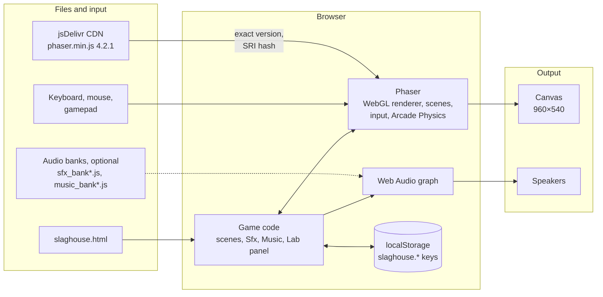

### Repository structure

```text
slaghouse/
├── slaghouse.html        The game. node src/join.mjs builds it from src/.
├── sfx_bank.js           Sampled SFX: Ogg Opus in base64 (optional).
├── sfx_bank_aac.js       The same SFX in AAC, for browsers without Ogg Opus.
├── music_bank.js         Soundtrack: Ogg Opus in base64 (optional).
├── music_bank_aac.js     The same soundtrack in AAC.
├── src/                  The 13 source parts and join.mjs.
├── dev/
│   ├── check.mjs         Static checks (local and CI).
│   ├── playtest/         Headless test harness, checks and the campaign bot.
│   ├── sfxgen/           AudioGen pipeline for the SFX bank. takes/ holds the FLAC takes.
│   ├── synthwave/        Offline synth engine and score for the soundtrack.
│   ├── audiolib/         loud.py: K-weighted loudness for both audio pipelines.
│   ├── build/            History: one-off scripts from before src/. They do not run on the current file.
│   ├── screenshots/      Screenshots from playtests.
│   └── ISSUES.md         The original issue drafts. The open ones are GitHub issues.
├── docs/                 Images for this README.
├── .github/              CI, release and Pages workflows, Dependabot, templates, CODEOWNERS.
└── .claude/launch.json   Local preview-server configuration for Claude Code.
```

### Source parts

`node src/join.mjs` joins the 13 parts of `src/` into `slaghouse.html` in a fixed order. It joins the bytes only. It
does not transform or minify them.

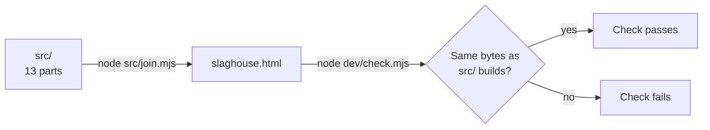

| Order | Part | Contents |
| --- | --- | --- |
| 1 | `page-head.html` | Header comment (all tuning values), CSS, the page DOM and the Lab panel, the script tags |
| 2 | `config.js` | `TUNE`, `WEAPONS`, `ENEMY`, `PROPS`, `PERKS`, `MEDALS`, options and saved data |
| 3 | `util.js` | Random helpers (`rand`, `fxRandom`), `BUS` (the event bus from the game to the HUD) |
| 4 | `audio.js` | `Sfx` and `Music`: the Web Audio graph, the synth voices and the bank loaders |
| 5 | `font.js` | The 5×7 pixel font |
| 6 | `art.js` | Sprite drawings, arenas, `NAV`, `CAMPAIGN`, `RUN_MODES`, `genTextures()` |
| 7 | `particles.js` | `FX`: the pooled pixel particles that can bounce or paint |
| 8 | `scenes.js` | `BootScene` and `TitleScene` |
| 9 | `game.js` | `GameScene`: player, enemies, weapons, props, hazards, campaign route, lifts |
| 10 | `hud.js` | `HudScene` |
| 11 | `lab.js` | `LAB_PANEL`: the logic of the Lab setup dialog |
| 12 | `boot.js` | `new Phaser.Game(...)`, and the pause on a hidden tab |
| 13 | `page-tail.html` | The closing tags |

### Boot and scenes

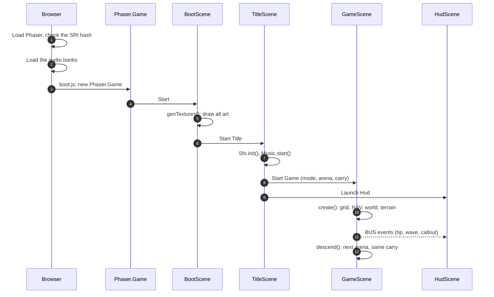

The carry holds the run state from one arena to the next: health, the equipped weapon, perks, medals, stats and the
wave number. In the campaign, it also holds the difficulty, the mutator and the run clock.

### One frame

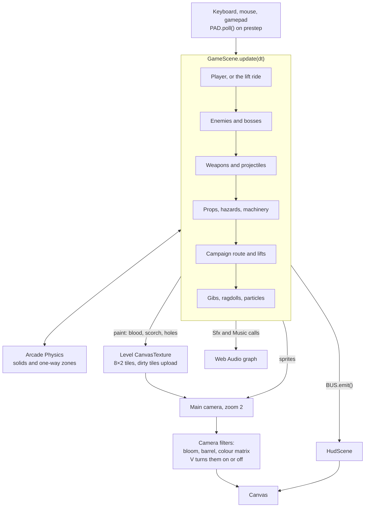

The game clock of `GameScene` runs only while the scene runs. Thus the pause menu stops all timers. A hidden tab
pauses the run and suspends the audio.

### Random streams

The seeded campaign tests require the same run from the same seed. For this reason, the game uses two random streams.

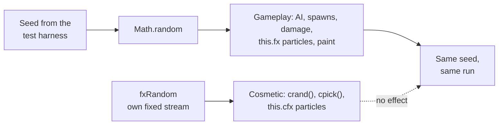

- Gameplay code uses `Math.random`, `rand`, `randi` and `pick`. The play-test harness replaces `Math.random` with a
  seeded generator.
- DAILY makes its arena, starting perks, waves and foes with `seeded()`, from the date. Thus all players receive the
  same run on one day.
- Cosmetic code uses `fxRandom`, `crand` and `cpick`. A particle emit with `cosmetic: true` goes to the cosmetic pool
  `this.cfx`.
- A cosmetic change thus does not change the seeded campaigns. Do not use a cosmetic emit for a particle that paints
  the level (`mode: 2`), because each paint uses `Math.random`.

### Saved data

The game keeps its data in `localStorage` only. All keys start with `slaghouse.`.

| Key | Data |
| --- | --- |
| `slaghouse.campaign.v1` | The campaign checkpoint |
| `slaghouse.best`, `slaghouse.bestEndless`, `slaghouse.bestRush`, `slaghouse.daily` | Records for each run mode |
| `slaghouse.life` | Lifetime kills, runs, deaths and time |
| `slaghouse.mastery` | Kills with each weapon |
| `slaghouse.medals`, `slaghouse.seen` | Medals, and the enemy kinds that the CODEX shows |
| `slaghouse.binds` | Key bindings |
| `slaghouse.postfx` and the option keys | Post FX, volume, screen shake, difficulty, mute and the other options |

## Pipelines

### Build, CI and release

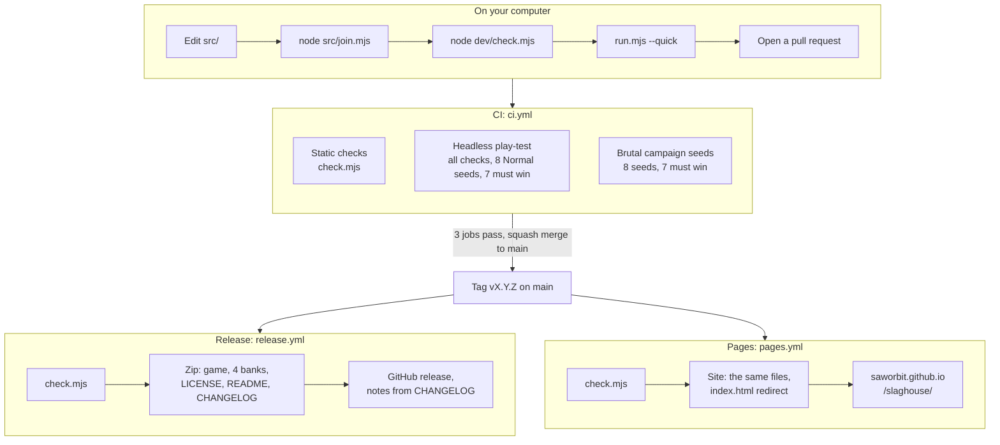

`node dev/check.mjs` does these checks:

- `slaghouse.html` is the same, byte for byte, as the output of `src/`.
- Each inline script and each audio bank compiles. Each AAC bank has the same sounds and tracks as its Opus bank.
- Each local `<script src>` exists. Each CDN script has an exact version and an integrity hash.
- Each entry in `dev/sfxgen/calib.json` agrees with the code of its procedural sound.
- It shows each sampled sound that the game asks for and that `sfx_bank.js` does not have.

`main` requires the three CI jobs before a merge. A `vX.Y.Z` tag starts the release workflow and the Pages workflow.
You can also start each workflow by hand: the release workflow as a dry run, and the Pages workflow to publish a
different ref. See [CONTRIBUTING.md](CONTRIBUTING.md#releasing).

### Art pipeline

The repository has no image files for the game. Each sprite is a function that draws pixels on a canvas. `BootScene`
calls `genTextures()` one time, and Phaser keeps the result as textures.

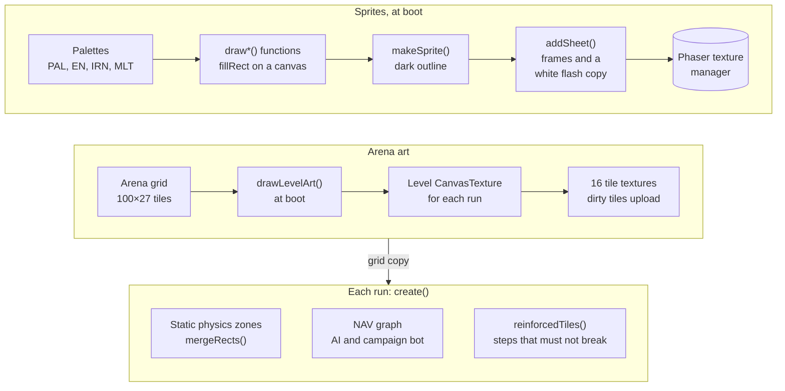

- The grid of an arena is 100 × 27 tiles of 16 pixels. Each tile is one character, for example `#` solid, `x`
  crate, `g` girder, `=` grating and `.` air.
- Each run uses a copy of the grid. When a tile breaks, the scene changes the copy and rebuilds `NAV`.
- Blood, scorch marks and bullet holes paint onto the level canvas. Only the tiles that changed upload to the GPU.
- Ragdoll parts (`RAG`) come from the same drawings as the living sprites. Thus a corpse looks like its enemy.
- `PROP_ART` draws the breakable props. `PROP_SPOTS` puts them in each arena.

### Audio pipelines

SLAGHOUSE has three audio layers. The procedural synth is always available. Two offline pipelines make the optional
banks. If a bank is missing, or a sound or track does not decode, the synth plays in its place.

#### Runtime audio graph

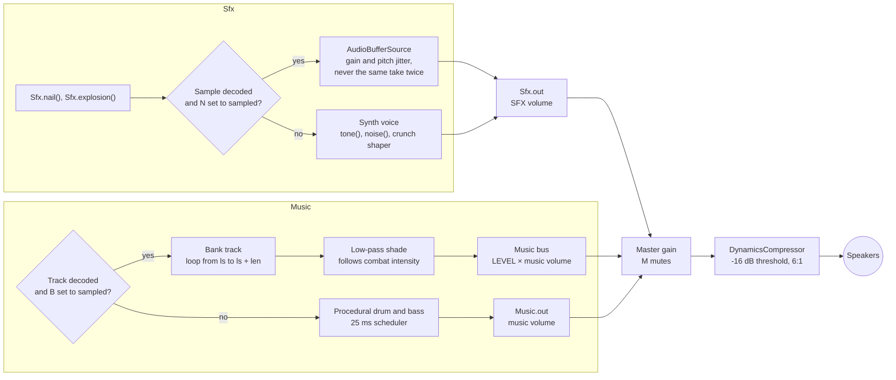

- Phaser audio is off. All sound goes through the `Sfx` and `Music` objects in `src/audio.js`.
- Each sampled sound keeps its synth version. **N** changes between the two. **B** does the same for the music.
- The stage loops stay muffled until an enemy sees you. They open up as the fight becomes more intense. The title, boss
  and jingle tracks always play at full level.

#### Bank loading

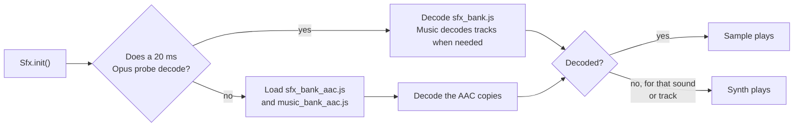

Each bank is a script that sets one global object:

| File | Global | Format of each entry |
| --- | --- | --- |
| `sfx_bank.js` | `window.SLAG_SFX` | `name: { g: gain, j: pitch jitter, d: [base64 Ogg Opus takes] }`. 200 sounds, 388 takes. |
| `music_bank.js` | `window.SLAG_MUSIC` | `name: { d: base64 Ogg Opus, loop, ls: loop start, len: loop length }`. 6 tracks. |
| `*_aac.js` | `window.SLAG_SFX_AAC`, `window.SLAG_MUSIC_AAC` | The same entries, as AAC in MP4. |

#### SFX bank pipeline (`dev/sfxgen`)

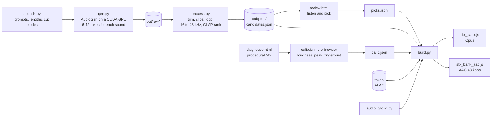

1. `sounds.py` gives each sound its prompts, length, cut mode and number of variants.
2. `gen.py` makes 6 to 12 AudioGen takes for each sound. The seed of a sound comes from its name.
3. `process.py` trims, slices and loops the takes, adds high-frequency "air" at 48 kHz and ranks the takes with CLAP.
4. `review.html` plays each take. You tick the picks and export `picks.json`. Sounds without an override use the
   top-ranked takes.
5. `calib.js` renders each procedural sound in the browser and measures its loudness and peak. The result goes in
   `calib.json`, with a fingerprint of the synth code.
6. `build.py` runs `calibcheck.mjs` first. It levels each take to the synth sound that it replaces, then encodes the
   Opus and AAC banks. It encodes again only the sounds that changed.

`takes/` holds every take that the bank uses, as FLAC (about 11 MB). On a new clone, `build.py` makes the same
`sfx_bank.js`, byte for byte, without a GPU or a model download. If a procedural sound changes, its `calib.json` entry
becomes stale, and `node dev/check.mjs` fails until you measure it again.

#### Soundtrack pipeline (`dev/synthwave`)

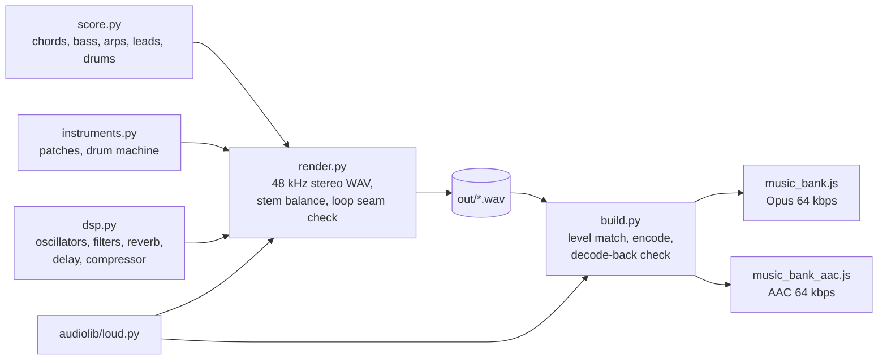

| Track | Use in the game |
| --- | --- |
| `title` | Title screen, and below the results screen after a jingle |
| `stage1` | Campaign waves 1-2. OVERTIME and DAILY waves 1-2 of every six |
| `stage2` | Campaign from the Furnace on, but not the Foreman and Smelter fights. OVERTIME and DAILY waves 3-5 of every six |
| `boss` | The Foreman and Smelter fights, all BOSS RUSH fights, OVERTIME and DAILY waves 6, 12, 18 and on |
| `win`, `lose` | The ARENA CLEARED fanfare and the YOU GOT GIBBED tape-stop |

- Each loop renders with 4 s of tail. The tail folds back onto the start, so the loop has no seam.
- `render.py` sets the loudness of each stem relative to the kick. If a loop has a seam, `render.py` does not write
  it and exits with status 1.
- `build.py` decodes each bank again after it writes it. It fails if a track is missing, a level is more than 0.5 dB
  from the target, or a loop seam does not align.
- The encodes are bit-exact. The same WAV files always give the same bank.

#### Audio tools

| Pipeline | Python | Other requirements |
| --- | --- | --- |
| SFX (`dev/sfxgen`) | 3.11 venv with PyTorch 2.5.1 and AudioCraft 1.3.0 | `ffmpeg` with libopus. A CUDA GPU only to make new takes. The first run downloads about 7 GB of models. |
| Soundtrack (`dev/synthwave`) | 3.13 venv from `requirements.txt` | `ffmpeg` with libopus. No GPU. |

The full procedures are in [dev/sfxgen/README.md](dev/sfxgen/README.md) and
[dev/synthwave/README.md](dev/synthwave/README.md).

### Test pipeline

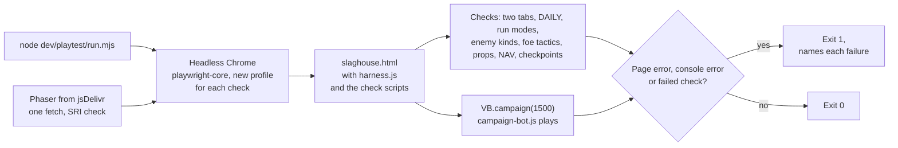

- The harness steps the game on a virtual clock. A full campaign thus runs faster than real time.
- The campaign bot uses the normal game mechanics. It plans its moves on the same `NAV` graph that the checks use.
- Each full campaign must win with the full kill count and leave no survivors.

| Command | What it runs |
| --- | --- |
| `node dev/playtest/run.mjs` | All checks, then the Normal campaigns (seeds 91, 404, 137, 5, 15, 1, 13 and 17; seven must win) |
| `node dev/playtest/run.mjs --quick` | All checks, without the full campaigns |
| `node dev/playtest/run.mjs --campaign --brutal --seeds=91,137,7,11,21,4,6,14 --min-wins=7` | The CI Brutal job |
| `node dev/playtest/compare.mjs` | A comparison of each enemy kind between the working tree and a git ref |

The [playtest guide](dev/playtest/README.md) has all options and the browser API.

## Development

### Change the game

1. Edit the files in `src/`. Do not edit `slaghouse.html`.
2. Build the page:

   ```bash
   node src/join.mjs
   ```

3. Run the static checks:

   ```bash
   node dev/check.mjs
   ```

4. Install the play-test tools. Do this one time:

   ```bash
   npm ci --prefix dev/playtest
   ```

5. Run the quick play-test:

   ```bash
   node dev/playtest/run.mjs --quick
   ```

6. Play the changed mode in a browser. Use the
   [campaign smoke check](CONTRIBUTING.md#campaign-smoke-check) or the [Lab smoke check](CONTRIBUTING.md#lab-smoke-check).
7. Add an entry to [CHANGELOG.md](CHANGELOG.md) below `[Unreleased]`.

> [!CAUTION]
> A change to props, hazards, enemies or timing can change the seeded campaigns. Run the Normal and Brutal seeds before
> you open a pull request. For a visual-only effect, use the cosmetic stream (see [Random streams](#random-streams)).

### Reference

- **Tuning.** Change a value in `TUNE` (`src/config.js`). Then change the header comment (`src/page-head.html`) to
  agree.
- **Breakable props.** `PROPS` and `PROP_BLAST` set how each kind plays: its HP, its mounting and its effect when it
  breaks. `PROP_ART` draws it, and `PROP_SPOTS` puts it in each arena. `dev/playtest/props.js` checks each spot in the
  campaign and OVERTIME layouts.
- **Enemies, bosses and run modes.** [CONTRIBUTING.md](CONTRIBUTING.md) tells you how to add them.
- **Audio.** To make the banks again, follow `dev/sfxgen/README.md` and `dev/synthwave/README.md`.
- **History.** See [CHANGELOG.md](CHANGELOG.md). To publish a release, follow the steps in
  [CONTRIBUTING.md](CONTRIBUTING.md#releasing).

## Contributing and security

Contributions are welcome. Read [CONTRIBUTING.md](CONTRIBUTING.md) before you open a pull request.

Do not report a security problem in a public issue. Report it privately, as [SECURITY.md](SECURITY.md) tells you.

## License

SLAGHOUSE is free software under the [MIT License](LICENSE). Copyright (c) 2026 Shane Wall.

The MIT License covers the code, the art, the soundtrack and the documentation of this repository. Third-party
components keep their own licenses:

- **Phaser** has the MIT License. The page loads it from the jsDelivr CDN. This repository does not include it.
- The sampled SFX in `sfx_bank.js`, `sfx_bank_aac.js` and `dev/sfxgen/takes/` come from Meta's **AudioGen**
  (`facebook/audiogen-medium`). The AudioGen model weights have the CC BY-NC 4.0 license. The MIT License of this
  repository does not remove limits that apply to the AudioGen output. Thus treat these samples as non-commercial.
  Each sampled sound has a synth version. If you remove the two SFX banks, the game still has sound.
