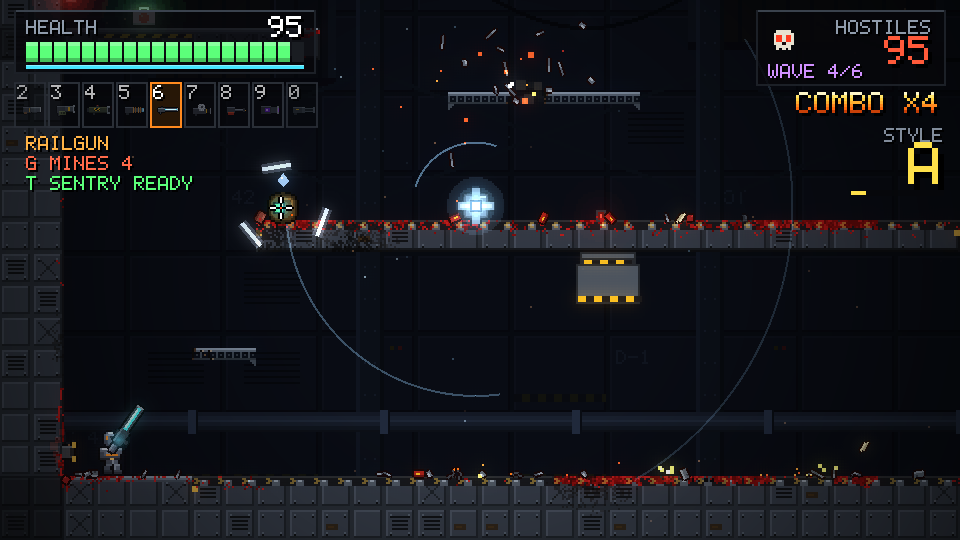

# SLAGHOUSE

[](https://github.com/saworbit/slaghouse/actions/workflows/ci.yml)
[](https://github.com/saworbit/slaghouse/releases)




A pixel-art side-scrolling arena shooter: one HTML file running on [Phaser 4](https://phaser.io/) with procedural
pixel art, ragdolls and gibs, destructible terrain, 61 weapons (each with mastery stars to earn, and gold plating at three), 94 enemy types
(with an in-game codex), power-up supply drops, three
arenas (five in OVERTIME) and six waves that end in a boss fight (plus an endless OVERTIME mode, a seeded DAILY run and a BOSS RUSH), a perk pick after every wave and 27 medals to collect, on Easy, Normal or Brutal, with keyboard
and mouse or a gamepad (with aim assist). The game runs in a browser with no build step.

## Play

The game loads Phaser 4.2.1 from the jsDelivr CDN, so it needs an internet connection. Serve the folder locally
(Python 3 shown) and open the page:

```bash
python -m http.server 8765 --bind 127.0.0.1
```

Then go to <http://localhost:8765/slaghouse.html> and click the game. The title menu has CAMPAIGN, OVERTIME (the
endless mode), DAILY (today's seeded OVERTIME run), BOSS RUSH (all five bosses back to back), CODEX (every enemy you've met), ARMORY (every gun, its kills and mastery stars), MEDALS and OPTIONS (including run **mutators**: glass cannon, swarm, moon boots, lights out, vampire); **W / S** to choose, **Enter** to pick, **A / D**
to change the difficulty, **E** to jump straight into OVERTIME.

`sfx_bank.js` (sampled sound effects) and `music_bank.js` (soundtrack) sit next to the page and load
automatically. Both are optional; without them the game uses its built-in procedural audio.

## Controls

| Action | Keys |
| --- | --- |
| Move | **A / D** or arrow keys |
| Jump / drop through a platform / wall jump | **Space** or **W** / **S + Space** / jump while sliding down a wall |
| Dash (8-way, i-frames) | **Shift** (kick straight out of a dash for a dropkick) |
| Aim and fire | mouse + left click (**J** fires when playing on the keyboard) |
| Kick / parry / execute (enemies pulsing orange) | **F** or right click |
| Prox mine | **G** or middle click |
| Auto-sentry | **T** |
| Grapple hook | **C** (press again to let go) |
| Pick a weapon | **1-9**, **0**, **-**, **=**, **Backspace**, **[**, **]**, `\`, **;**, **'**, **,**, **.**, **/**, **Z**, **X**, **K**, **L**, **U**, **I**, **O**, **Y**, **H** (the chain flail, orbital designator, plasma cutter, spider mines, napalm launcher, bee swarm, laser whip, shrink ray, sonic blaster, grav bomb, pinball cannon, firework launcher, plasma katana, scrap vacuum, siphon, splitter, decoy launcher, stasis grenade, microwave, rocket gauntlet, marksman rifle, tripwire, drone pod, gas launcher, bubble gun, riot shield, glue gun, mini-nuke, dragon's breath, seed launcher and tether gun have no key: use the wheel or Q/E) |
| Weapon wheel (time slows while it's open) | hold **Tab** |
| Cycle weapons | **Q / E** or mouse wheel |
| Pause menu (resume, restart, post FX, screen shake, music and SFX volume, quit to title) | **Esc** or **P** |
| Restart run | **R** |
| Post-processing on / off | **V** |
| Mute / sampled vs synth SFX / sampled vs synth music | **M** / **N** / **B** |

On a gamepad: left stick moves (down + **A** drops through a platform), right stick aims, **RT** fires, **LT** throws a
mine, **A** jumps, **B** dashes, **X** kicks, **Y** fires the hook, **RB** drops the sentry, hold **LB** for the weapon
wheel (pick with the right stick), the D-pad cycles weapons and **Start** pauses. Menus take the D-pad or left stick,
**A** and **B**.

## Weapons

| Key | Weapon | Key | Weapon |
| --- | --- | --- | --- |
| 1 | Nailgun | 8 | Slag hose |
| 2 | Shotgun | 9 | Singularity |
| 3 | Grenade launcher | 0 | Rivet minigun |
| 4 | Rocket launcher | - | Cluster mortar |
| 5 | Arc caster | = | Stake driver |
| 6 | Railgun | Backspace | Cryo cannon |
| 7 | Saw launcher | [ | Prism laser |
| ] | Ripper (held chain blade; kills heal you) | `\` | Hornet pod (hold to lock on, release to launch) |
| ; | Magma lance (hold to charge, release to fire) | ' | Glaive (thrown ring that comes back; hold to grind) |
| , | Forge hammer (tap to swing; hold for a shockwave slam, or a ground-pound in the air) | . | Storm coil (sticky tesla coils that link into fences; hold to overload) |
| / | Flak cannon (bursts into ricocheting shrapnel) | Z | Tractor (hold to grab drums, corpses or light enemies; release to throw) |
| X | Corroder (acid cone; corroded enemies take +40% damage, shields melt) | K | Shock rifle (tap: plasma orb; hold: beam; beam an orb for a combo) |
| L | Needler (homing needles; seven in one target supercombine) | U | Drill launcher (bores through scenery, grinds into a body, then blows) |
| I | Trick revolver (six rounds; wall shots ricochet into the nearest foe) | O | Flare gun (sticky flares that burn and light foes up in the dark) |
| Y | Limpet launcher (tap: sticky bomb; hold: set them all off) | H | Net gun (tangles foes for 3 s; fliers drop) |
| wheel | Chain flail (hold: whirl it round you; release: hurl it) | wheel | Orbital designator (hold to paint a spot; a sky laser follows) |
| wheel | Plasma cutter (piercing plasma blades that slice crates) | wheel | Spider mines (crawling bombs that hunt the nearest foe) |
| wheel | Napalm launcher (fuel cans that splash fire across the floor) | wheel | Bee swarm (a pod of homing stingers) |
| wheel | Laser whip (a long crack that drags foes in) | wheel | Shrink ray (shrinks a foe; land on it to squish it) |
| wheel | Sonic blaster (a cone of sound that shoves and stuns) | wheel | Grav bomb (floats foes up, then slams them down) |
| wheel | Pinball cannon (a steel ball that hits harder every bounce) | wheel | Firework launcher (wild rockets that burst into burning stars) |
| wheel | Plasma katana (a slash that bats enemy shots back; slash out of a dash for a dash cut) | wheel | Scrap vacuum (hold: suck up gibs and corpses; let go: blast them out) |
| wheel | Siphon (a drain beam that heals you as it hurts) | wheel | Splitter (a bolt that splits in two every time it hits) |
| wheel | Decoy launcher (a hologram of you that draws foes in, then blows up) | wheel | Stasis grenade (stops time in a bubble; hits stack up and land together) |
| wheel | Microwave (cooks a foe until it pops) | wheel | Rocket gauntlet (a thruster punch that carries you into them) |
| wheel | Marksman rifle (laser-sighted, pierces, triple-damage headshots) | wheel | Tripwire (a laser beam that zaps whatever crosses it) |
| wheel | Drone pod (two gun drones orbit you for 10 s) | wheel | Gas launcher (a cloud of your own gas; light it for a fireball) |
| wheel | Bubble gun (floats foes up in bubbles; pop them to drop them) | wheel | Riot shield (hold to block and reflect shots, let go to bash) |
| wheel | Glue gun (gums foes up so they crawl) | wheel | Mini-nuke (one slow shell, one very big bang) |
| wheel | Dragon's breath (burning buckshot) | wheel | Seed launcher (plants a fungus turret that spores foes) |
| wheel | Tether gun (links three foes: hurt one, hurt all) | | |

The comment at the top of `slaghouse.html` documents every weapon, enemy, wave and tuning value.

## Waves

Each arena holds two waves: **ARENA 01 :: THE MELT FLOOR** (waves 1-2), **ARENA 02 :: THE FURNACE** (waves 3-4)
and **ARENA 03 :: THE SORTING LINE** (waves 5-6), where conveyor belts carry everything and crusher presses slam
down on a tell. Clearing an arena takes you down the lift with your health, gun, perks and stats carried over.

1. 10 placed enemies.
2. 22 enemies in a **BLACKOUT**: you only see a small circle around you, and gunfire lights it up. Includes a
   mirror knight that reflects your shots, a wraith that drifts through walls, a tar spitter whose puddles slow you (and burn when lit), a mimic
   hiding among the drums, a gasbag whose toxic cloud goes up in a fireball if you light it, a creeper that
   drops off the ceiling, a scorcher that sprints trailing fire, a discus thrower whose disc comes back, an arc pylon that throws lightning, a berserker, a soul-drinking zealot, a jellyfish trailing shock tendrils, a burning cinder wheel (kick it back), a grenadier and a pack of sparkers that link up with live arcs.
3. 21 enemies under **SLAG RAIN**, with a scrap golem that lobs junk over cover, a shellback you have to flip, a pyro, a torcher with a flamethrower (get behind it), a harpooner, a corpse-raising stitcher, a ricocheting buzzsaw
   (kick it back), a pilferer that steals your gun, a beacon that calls in reinforcements, leeches, a spotter whose red eye marks you for every foe, a
   duelist that sidesteps your shots, an armoured roller, a lugger that hurls drums, a bastion behind a hard-light wall, a porcupine that answers every hit with quills, a bulldozer that plows everything ahead of it, an orbiter whose spinning plates eat your shots and the gunship mini-boss.
4. 22 enemies in **LOW GRAVITY**, led by the juggernaut mini-boss, with a pair of linker fence drones, a hive
   that keeps a gnat swarm going, a pair of pouncing hounds, a crane claw that grabs you from above, a magnetron whose field bends your shots away, a vortex drone that drags you in, a thundercloud that drops lightning on you, a teleporting blinker
   a howitzer that shells you from range, a welder that repairs the machines and builds turrets, and a jammer whose
   EMP ring jams your gun, a pogo, a spikeball, a bomber blimp, a chiller that ices the floor, a spore pod that puffs homing spores, a mine layer that seeds the floor with mines, a sponge that soaks up bullets and spits them back, a banner bearer that heals everything near it and an acid slug. The furnace's fire vents go off every few seconds.
5. 20 enemies (26 once the slagling splits) in **MELTDOWN**: molten slag floods the ground floor for 6 s at a
   time, about every 25 s. A slagling, a rat king that bursts into ratbots, a burrower, a scavenger that eats the dead to grow, linkers, an echo, a laser strider, a warhorn that rallies the rest, a wall-leaping shinobi, a beacon,
   a paratrooper, a swapper that trades places with you, a tar spitter, a grappler that hurls you across the room, an axe-swinging headsman, a leaper that lands where you stood, a copycat that copies your gun, a gatling that hoses the room and the Slag Wyrm mini-boss.
6. THE SMELTER, the boss. Below 15% health it overheats: its armour blows off and it fans slag everywhere.

**OVERTIME** (E on the title screen) is endless: random waves that grow and toughen, a mini-boss every few waves,
a boss every sixth (the Smelter and THE FOREMAN, a four-legged crane walker, take turns), a perk after each wave and a new arena every three, including THE WRECKING YARD,
with a wrecking ball swinging across the middle, and THE POWERHOUSE, whose floor rails go live in turns. Your best wave is kept. Every enemy
type can turn up, from echoes (holograms that replay your path and shots) to wraiths and warhorns.
**DAILY** is an OVERTIME run seeded by the date: the same arena, starting perks, waves and modifiers for everyone
that day (mutators are switched off for it).

Every kill counts toward that gun's **mastery** (three stars gold-plate it): 25, 100 and 250 kills earn its three stars, each +5% damage with
it. The weapon wheel shows each gun's stars.

Medkits restock between waves, and after each wave you pick one of three perks for the rest of the run (more
damage, faster fire, life steal, a double jump, exploding kills and so on). Steam pipes on the walls burst into
scalding jets when shot. Quick kills chain into DOUBLE KILL, TRIPLE and on up to MASSACRE. From wave 2, a few foes warp in as **elites**
(armored, shielded, volatile or regenerating, marked by a coloured diamond) that drop health when they die. Medals pop up as you earn them, and the title screen counts your collection. Supply
crates float down mid-wave with a power-up: OVERDRIVE (double damage), HASTE, an AEGIS shield or a MEDPACK. Kicking an enemy that's pulsing orange (under 20% health) executes it for health
orbs. The results screen lists your top guns, your biggest hit and what killed you, grades the run (S-D) and
keeps your best score.

## Project layout

| Path | What it is |
| --- | --- |
| `slaghouse.html` | The whole game. Tuning values live in the `TUNE` object, and the header comment records them. |
| `sfx_bank.js` | Optional sampled SFX bank (Opus, base64), generated by `dev/sfxgen`. |
| `music_bank.js` | Optional synthwave soundtrack (Opus, base64), rendered by `dev/synthwave`. |
| `versions/` | Snapshots of `slaghouse.html` taken before each update round (`slaghouse.before-<round>.html`). |
| `dev/sfxgen/` | AudioGen pipeline for the SFX bank; see its README. |
| `dev/synthwave/` | Offline synth engine and score for the soundtrack; see its README. |
| `dev/build/` | One-off scripts and code snippets that applied each update round to `slaghouse.html`. Already applied; they won't re-run against the current file. `recv.py` receives playtest screenshots. |
| `dev/screenshots/` | Screenshots from playtesting. |
| `dev/ISSUES.md` | The original issue drafts; the open ones are filed as [GitHub issues](https://github.com/saworbit/slaghouse/issues). |
| `dev/check.mjs` | Static checks run by CI (and locally with `node dev/check.mjs`). |
| `docs/` | Images for this README. |
| `.github/` | CI workflow, Dependabot, issue and pull request templates, CODEOWNERS. |
| `.claude/launch.json` | Local preview-server configs for Claude Code. |

## Development notes

- **Tuning:** change the values in `TUNE` (top of the script) and update the header comment to match.
- **Checks:** `node dev/check.mjs` compiles the game script and both audio banks and checks the script tags; CI runs
  it on every push to `main` and every pull request.
- **Testing:** there are no automated gameplay tests yet. Playtesting has been done by driving the game from the
  browser console; saving that as a smoke test is an open issue.
- **Audio:** to regenerate the sound banks, follow `dev/sfxgen/README.md` and `dev/synthwave/README.md`. Both
  need a Python 3.11 venv and `ffmpeg` with libopus; the SFX pipeline also needs a CUDA GPU.
- **History:** see [CHANGELOG.md](CHANGELOG.md).

## Contributing and security

Contributions are by invitation; see [CONTRIBUTING.md](CONTRIBUTING.md). Report security problems privately as
described in [SECURITY.md](SECURITY.md).

## Licensing

Copyright (c) 2026 Shane Wall. All rights reserved. SLAGHOUSE is proprietary software: no part of it may be copied,
modified or distributed without written permission. See [LICENSE](LICENSE).

Third-party components keep their own licenses:

- **Phaser** is MIT-licensed and loaded from the jsDelivr CDN; it isn't included in this repository.
- The sampled SFX in `sfx_bank.js` were generated with Meta's **AudioGen** (`facebook/audiogen-medium`), whose model
  weights are licensed CC BY-NC 4.0, so treat that bank as non-commercial. Every sampled sound has a synth fallback,
  so the game can ship without it.
